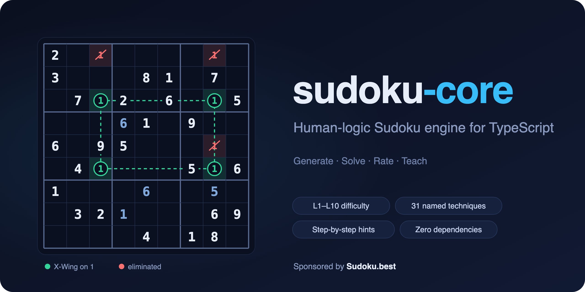

A TypeScript Sudoku package for generating, solving (step-by-step or all), and analyzing Sudoku boards with ease. Perfect for building Sudoku games and integrating Sudoku functionality into your applications.

<div align="center">

  <a href="https://github.com/komeilmehranfar/sudoku-core">
    
  </a>

  <h3>Sudoku Solver and Generator</h3>

  <p>
    <a href="https://github.com/komeilmehranfar/sudoku-core"><strong>Explore the docs »</strong></a>
    ·
    <a href="https://codesandbox.io/s/cold-fast-vvrf2d?file=/src/index.ts">View Demo</a>
    ·
    <a href="https://github.com/komeilmehranfar/sudoku-core/issues">Report Bug</a>
    ·
    <a href="https://github.com/komeilmehranfar/sudoku-core/issues">Request Feature</a>
  </p>

  <p>
    <a href="https://www.npmjs.com/package/sudoku-core"></a>
    <a href="https://www.npmjs.com/package/sudoku-core"></a>
    <a href="https://github.com/komeilmehranfar/sudoku-core/stargazers"></a>
    <a href="https://github.com/komeilmehranfar/sudoku-core/issues"></a>
    <a href="https://github.com/komeilmehranfar/sudoku-core/blob/main/LICENSE"></a>
  </p>

</div>

## Table Of Contents

- [Getting Started](#getting-started)
  - [Installation](#installation)
  - [Inputs](#inputs)
  - [Methods](#methods)
- [Usage](#usage)
- [Roadmap](#roadmap)
- [Contributing](#contributing)
- [License](#license)
- [Authors](#authors)
- [Acknowledgements](#acknowledgements)

## About the package

**Key Features**:

- **Board Generation**: Create unique puzzles across difficulty bands `L1` … `L10` (optional seed for deterministic dailies).
- **Human-logic Solver**: Solve with classical techniques — not brute force.
- **Step-by-Step Hints**: Walk through the next technique, ideal for teaching and UX.
- **Board Analysis**: Rate difficulty, techniques used, and uniqueness.

## Getting Started

### Installation

```sh
npm install sudoku-core@latest
```

### Usage

| function              | Input                                                | Output                  |
| --------------------- | ---------------------------------------------------- | ----------------------- |
| [generate](#generate) | "L1" … "L10"                                         | Board                   |
| [solve](#solve)       | Board                                                | [SolvingResult](#solve) |
| [hint](#solveStep)    | Board                                                | [SolvingResult](#hint)  |
| [analyze](#analyze)   | Board                                                | [AnalyzeData](#analyze) |

board:

- it has numbers from 1-9 or null
- it has 81 cells
- it's solvable (not by brute force)
- there is only one version of answer to this board (not the process, the result)
  [1,null,9,5,8,null,null,6,3, ... 81 items]

#### generate

- Generates a new Sudoku puzzle.

```typescript
// difficulty: L1 (easiest) … L10 (hardest)
const board = generate("L4");

// optional: deterministic puzzle (e.g. daily challenge)
const daily = generate("L3", { seed: 20261020 });
console.log(board, daily);
```

```json
[
  1,
  null,
  9,
  5,
  8,
  null,
  null,
  6,
  3
  //... 81 items
]
```

#### solve

- Solves the entire puzzle.

```typescript
const solvedBoard = solve(board);
console.log(solvedBoard);
```

```json
{
  "solved": true,
  "board": [
    2,
    7,
    6,
    3,
    8,
    1,
    9
    // ... 81 items
  ],
  "steps": [
    {
      "strategy": "Single Candidate Strategy",
      "updates": [{
        "index": 5,
        "filledValue": 1,
        "eliminatedCandidate": null,
      }],
      "type": "value"
    },
    ...steps
  ],
  "analysis": {
    "hasSolution": true,
    "hasUniqueSolution": true,
    "usedStrategies": [
      { "title": "Single Remaining Cell Strategy", "frequency": 21 },
      ...strategies
    ],
    "difficulty": "L8",
    "score": 2232,
    "hardestRank": 4.2
  }
}
```

#### hint

- Solves the next step of the puzzle and return steps.

```typescript
const solvedBoard = hint(board);
console.log(solvedBoard);
```

```json
{
  "solved": true,
  "board": [
    null,
    7,
    6,
    null,
    null,
    1, // null => 1
    null
    // ... 81 items
  ],
  "steps": [
    {
      "strategy": "Single Candidate Strategy",
      "updates": [{
        "index": 5,
        "filledValue": 1,
        "eliminatedCandidate": null,
      }],
      "type": "value"
    }
  ],
  "analysis": {
    "hasSolution": true,
    "hasUniqueSolution": true,
    "usedStrategies": [
      { "title": "Single Remaining Cell Strategy", "frequency": 21 },
      ...strategies
    ],
    "difficulty": "L8",
    "score": 2232
  }
}
```

#### analyze

- Returns an analysis of the current board state.

```typescript
const analyzeData = analyze(board);
console.log(analyzeData);
```

```json
{
  "hasSolution": true,
  "hasUniqueSolution": true,
  "usedStrategies": [
    { "title": "Open Singles Strategy", "freq": 21 },
    { "title": "Single Candidate Strategy", "freq": 11 },
    { "title": "Visual Elimination Strategy", "freq": 29 },
    { "title": "Pointing Elimination Strategy", "freq": 27 }
  ],
  "difficulty": "L4",
  "score": 1683.1,
  "hardestTechnique": "Pointing Elimination Strategy",
  "hardestRank": 2.6,
  "tedium": 1.4
}
```

## Project Stats


## Roadmap

See the [open issues](https://github.com/komeilmehranfar/sudoku-core/issues) for
a list of proposed features (and known issues).

## Contributing

Contributions are what make the open source community such an amazing place to
be learn, inspire, and create. Any contributions you make are **greatly
appreciated**.

- If you have suggestions for adding or removing projects, feel free to
  [open an issue](https://github.com/komeilmehranfar/sudoku-core/issues/new) to
  discuss it, or directly create a pull request after you edit the _README.md_
  file with necessary changes.
- Please make sure you check your spelling and grammar.
- Create individual PR for each suggestion.

### Creating A Pull Request

1. Fork the Project
2. Create your Feature Branch (`git checkout -b feature/AmazingFeature`)
3. Commit your Changes (`git commit -m 'feat: Add some AmazingFeature'`)
4. Push to the Branch (`git push origin feature/AmazingFeature`)
5. Open a Pull Request

## License

Distributed under the MIT License. See
[LICENSE](https://github.com/komeilmehranfar/sudoku-core/blob/main/LICENSE)
for more information.

## Authors

- [Komeil Mehranfar](https://github.com/komeilmehranfar)
  - Frontend Engineer at [iO](https://iodigital.com)

## Acknowledgements

- [Komeil Mehranfar](https://github.com/komeilmehranfar/)

## References

- Inspired by [Jonas Ohlsson Aden](https://github.com/pocketjoso/sudokuJS)
